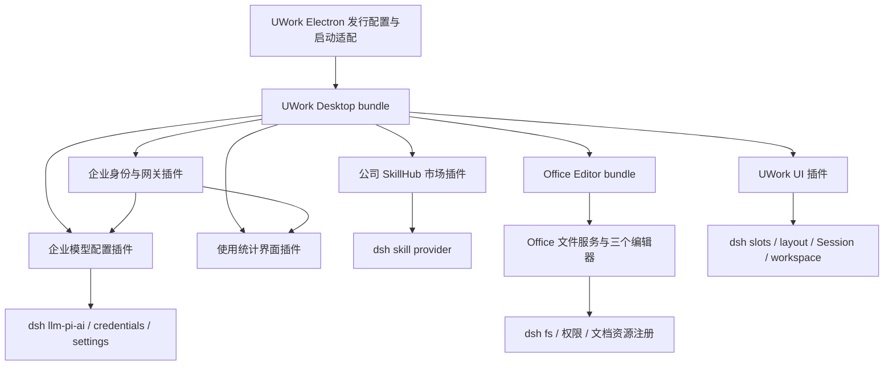

# UWork 桌面版插件化迁移方案

## 摘要

在当前 deepseek-harness fork 中交付 UWork 桌面体验，首发平台为 Windows x64 和 macOS Apple Silicon。采用 UWork 发行 bundle、业务插件、Office 编辑插件及少量通用桌面适配，保留 dsh 的 Agent、Session、模型适配器、权限和插件生命周期。整体 UI 迁入包含品牌、布局、导航、主题、组件呈现和交互状态；企业微信登录、模型自动配置、公司市场、企业网关统计以及 Office 编辑均须形成可用闭环。

本文是实施方案，不表示功能已经迁入或通过桌面验收。详细工作项及依赖见 [执行清单](todo.md)。

## 目录

- [范围与验收边界](#范围与验收边界)
- [现有实现与迁移依据](#现有实现与迁移依据)
- [插件与发行结构](#插件与发行结构)
- [UWork 界面体系](#uwork-界面体系)
- [企业微信与模型自动配置](#企业微信与模型自动配置)
- [公司市场](#公司市场)
- [企业网关使用统计](#企业网关使用统计)
- [Office 文档编辑](#office-文档编辑)
- [配置目录与旧版本共存](#配置目录与旧版本共存)
- [桌面打包与升级](#桌面打包与升级)
- [实施顺序与工作量](#实施顺序与工作量)
- [验收与发布条件](#验收与发布条件)
- [持续合并上游](#持续合并上游)
- [实施前需要落实的资源](#实施前需要落实的资源)

## 范围与验收边界

2026-11-10 用户已确认首发仅 Windows x64、Mac ARM，并要求 Office 文档编辑以 dsh 插件形式迁入。超出以下范围的源仓库功能暂不嵌入。

| 本次交付 | 必须达到的结果 |
|---|---|
| UWork 全套 UI 体系 | UWork 字标与 U 图标、UCAS 首页、浅暗主题、助理/开发模式、侧栏及任务导航、对话/输入/模型选择、设置和工作台呈现协调统一；已有 dsh 能力保持可用 |
| 企业微信扫码及自动模型配置 | 桌面首次启动能扫码；登录后自动得到企业网关、Key、模型和默认选择；重启、失效、注销、切换账号行为完整 |
| 插件市场的公司市场 | 对接源项目已有 PUBLIC SkillHub，完成发现、搜索、安装、更新、启停、卸载和重启恢复 |
| 使用统计中的企业网关 | 账号、网关、套餐、周期用量、趋势、模型分布和同步状态来自企业服务端 |
| 系统配置目录 `.uwork` | 新引擎配置、凭证、会话、插件和缓存集中在 `.uwork` 内独立子目录；桌面与捆绑 CLI 一致 |
| Office 文档编辑 | Word、Excel、PPT 均可打开、编辑、保存、另存为、重开；通过独立 dsh bundle 装配，具备权限、外部修改冲突和未保存保护 |
| 桌面发行 | 两个目标平台均提供安装包，并验证签名、首次启动、原生能力、升级和失败恢复 |

不纳入本次：完整 Git 分支图迁移、Workflow 图编辑器及旧运行引擎、手机远控、IM、营销与商业权益后台、Intel Mac、原生 Windows ARM64、旧 ZCode/UWork 全量会话转换。dsh 自身已有相关功能不因本方案被删除；它们可以采用统一主题，但不额外搬入源项目的独立业务系统。

“全套 UI”按上述交付范围内的完整页面和状态验收，不以只换 Logo 达标，也不以展示无法工作的源页面占位达标。

## 现有实现与迁移依据

调研基线为 2026-11-10 读取的 [Jas0nxlee/UWork](https://github.com/Jas0nxlee/UWork) 默认 `uwork` 分支（产品 3.16.8）以及当前 fork 的 `master`（dsh 0.2.2-rc.1）。本地 fork 与当时的 origin/master 一致，调研开始时工作区干净。实施时记录当次代码基线及差异，不假定后续远端仍相同。

| 发现 | 方案影响 | 源码依据 |
|---|---|---|
| 源 UI 为 React 19、Zustand、ZCode RPC，目标为 React 18、Cordis Client/slots/remote | 移植视觉与交互，重新绑定状态与服务；不整体挂载旧 UI 应用、不为迁 UI 升级整个 dsh React | [源 UI manifest](https://github.com/Jas0nxlee/UWork/blob/uwork/packages/ui/package.json)、[目标 Web manifest](../apps/web/package.json) |
| 主题、品牌、设置、全局面板和市场已有插槽 | 新能力主要由插件接入 | [theme](../packages/client/ui-theme/src/client/index.ts)、[品牌](../packages/client/ui-brand-official/src/client/index.ts)、[市场插槽](../packages/client/ui-plugin-manager/src/client/slot-contract.ts) |
| 原生首次启动向导和默认模型初始化仍绑定 DeepSeek account | 必须适配桌面入门；企业插件自行保存企业默认模型 | [Welcome](../apps/desktop/src/welcome-backend.ts)、[初始化模型](../packages/api/session-controller/src/index.ts)、[默认模型服务](../packages/core/agent-default-model/src/index.ts) |
| 公司市场是匿名 SkillHub 技能包，不是 npm/Cordis bundle | 增加技能目录与安装适配，不能直接传给 dsh 插件安装器 | [市场定义](https://github.com/Jas0nxlee/UWork/blob/uwork/packages/shared/src/plugin-marketplaces.ts)、[下载与指纹](https://github.com/Jas0nxlee/UWork/blob/uwork/apps/zcode-cli/packages/adapters/src/plugins/skillhub-package.ts) |
| 企业网关使用统计为远端数据 | 不把本地 Session token 合计作为企业账单 | [源网关 UI](https://github.com/Jas0nxlee/UWork/blob/uwork/packages/ui/src/settings/ucas-gateway/UcasGatewayPanel.tsx) |
| 旧 UWork 已使用 `.uwork/v2`、`.uwork/cli` 及 UWork 系列 Electron 身份 | 新引擎需要目录和发行身份隔离 | [旧数据根规则](https://github.com/Jas0nxlee/UWork/blob/uwork/specs/uwork-data-root-separation.md)、[目标路径解析](../packages/util/home-paths/src/index.ts) |
| 目标现有 Office 预览不能等同于源 Word/Excel/PPT 编辑保存 | Office 单列服务、前端、格式适配和桌面资源验收 | [源编辑端口](https://github.com/Jas0nxlee/UWork/blob/uwork/packages/ui/src/officeEditor/contract.ts) |

源项目 LICENSE 标明 Apache-2.0，当前 fork 标明 MIT；迁入代码、图标和第三方编辑器材料逐项保留其已有许可和归属信息，不把所有移入文件统一改写成 MIT。具体资产清单随迁移提交维护。

## 插件与发行结构



以下包名及新增目录是拟定组织，不代表仓库已经存在这些包。沿用 `@deepseek-ai/dsh-*` 内部命名，包名包含 `uwork` 以标明所有者；面向用户显示 UWork。

| 拟定包 | 所属目录 | 职责 |
|---|---|---|
| `dsh-uwork-desktop` | `packages/bundle/uwork-desktop` | UWork 装配清单、默认配置、启停官方品牌/账号贡献、内置恢复集合 |
| `dsh-client-ui-uwork` | `packages/client/ui-uwork` | 主题、品牌、首页、导航、助理/开发呈现；必要时拆出布局展示包 |
| `dsh-uwork-enterprise` | `packages/credentials/uwork-enterprise` | 企微身份状态机、企业 API、网关账号与用量读取、脱敏 Remote API、企业账号 Client 面 |
| `dsh-uwork-model-provisioning` | `packages/llm/uwork-model-provisioning` | 企业模型目录、凭证引用、受管 provider 配置及默认模型策略；复用 pi-ai 传输 |
| `dsh-uwork-company-market` | `packages/boot/uwork-company-market` | PUBLIC SkillHub 目录、版本、校验下载、技能启停和安装记录，含市场 Client 面 |
| `dsh-client-ui-uwork-usage` | `packages/client/ui-uwork-usage` | “使用统计 → 企业网关”，读取企业服务，不再建一份身份或凭证状态 |
| `dsh-uwork-office-editor` | `packages/bundle/uwork-office-editor` | Office 独立安装和启停单元，装配文件服务及 Word/Excel/PPT 编辑器 |
| `dsh-uwork-office-storage` | `packages/document/uwork-office-storage` | 有权限的文件读写、revision、备份和保存，提供脱敏且类型明确的 Remote API |
| `dsh-client-ui-uwork-office-editor` | `packages/client/ui-uwork-office-editor` | 三种格式懒加载编辑器、功能区、dirty/保存状态及文档注册；纯编解码按实际重用提取到 document 组库 |

新增包需补所在 package-group 文档、产品分类、构建图和发布收集；不能为绕过正式验收而默认放入 experimental。bundle、可挂载插件及纯格式库分别声明其类型，不将库伪装成可安装插件。各 Host/Client 双面包提供独立 leaf tsconfig，Client 不导入文件系统、密钥或 Host 实现。

所有注册通过 `ctx.effect()` / `ctx.on()` 及其 disposer 管理。插件卸载或 HMR 后释放订阅、轮询、编辑资源、主题覆盖和槽位。运行时配置由 schema 校验；服务地址、时间间隔、容量限制、来源配置等可部署参数均为 Config 字段。

### 少量需要落在插件外的改动

| 改动 | 为什么不能只做普通插件 | 控制方式 |
|---|---|---|
| 产品名、图标、appId、更新源、签名配置 | 构建及 Electron 初始化发生在插件加载前 | 集中发行配置，供构建/Main/校验脚本读取 |
| `.uwork` 默认路径及捆绑 CLI 路径 | profile 和凭证文件在 Cordis 启动前解析 | 一处 bootstrap 解析，继续传递上游 `DSH_HOME` |
| 原生首次启动/扫码视图 | 需要 Electron 安全容器、窗口与导航生命周期 | 通用载体接口；企业业务留在插件 |
| 全局布局展示替换 | 当前 layout/sidebar 同时拥有服务、渲染与子槽位声明 | 优先增加通用 presenter 扩展点，保留唯一 owner；仅在更简单时替换完整展示插件并保持接口 |
| Office 编辑动作的文档入口 | 现有入口若只接受预览，缺少可注册编辑动作 | 补通用 editor/action 注册，不在核心组件添加 Word/Excel/PPT 分支 |
| 受权限控制的二进制保存 | 当前 fs 有 readBytes，但写入仅有文本相关接口；workspace-files 为只读 | 在 fs 能力中补二进制原子写及版本检查，更新实际 provider/策略；Office 使用公开接口 |
| 可取消的关闭守卫 | 当前 right-sidebar close handler 为同步通知，随后立即移除标签 | 增加可等待保存、可拒绝关闭的通用接口，统一所有关闭入口 |

不修改 agent-loop 实现企业业务，不全仓替换 `.dsh`、内部包名或协议名，不在上游组件遍布 `isUwork` 条件，不导入旧 ZCode 引擎。

## UWork 界面体系

### 页面和组件映射

| 区域 | 迁移内容 | 接入方式 |
|---|---|---|
| 首开与主首页 | U 图标、UWork 字标、UCAS 深浅背景、问候、企微登录状态 | 静态启动资源 + `conversation.hero.frame` + onboarding |
| 主题与组件 | 字体层级、颜色、间距、控件尺寸、分割线、弹窗、菜单、Toast、空/错/加载状态 | `ctx.theme.register/overrideTokens`；复用 dsh primitives，必要时局部展示组件 |
| 导航与模式 | 紧凑侧栏、项目/任务树、助理/开发单按钮、折叠与恢复 | 品牌/sidebar slots、layout、workspace/session、插件自己的偏好状态 |
| 对话与输入 | 消息排版、工具卡片、模型菜单、附件、草稿、队列、停止、审批和询问 | 保留 dsh Session 事件及动作，仅调整渲染/组合 |
| 工作台 | 文件、终端、浏览器、文档标签与 Office 编辑 | dsh 资源身份、rightbar/dock slots、编辑器注册 |
| 设置 | 一般、外观、账号、模型、技能/MCP、插件、使用统计及本次新增能力 | settings slots；不复制旧配置对象 |
| 公司市场和企业网关 | 保持源入口位置和信息层级，融入统一 UWork 页面 | `plugins.tab`、settings/global panel slots |
| 原生桌面 | 窗口标题、菜单、关于、安装界面、应用图标、拖拽区与窗口按钮避让 | 集中品牌资源及 Desktop carrier |

助理/开发模式先列出源模式对导航、工具显示、工作台和快捷动作的实际影响，再映射到 dsh。纯显示差异可由 UI 状态控制；任何影响工具或模型可见内容的差异必须走 preset/Session 机制并有回放证据，不能用未记录的 Client 布尔值改变执行。

主题覆盖不依赖上游内部 CSS 类名穿透。源样式与仓库的字重、圆角、焦点和可访问性规范冲突时，用 dsh 组件实现同一信息层级，不复制全局禁用焦点等规则。原生顶栏分别遵守 Mac 交通灯和 Windows 标题栏区域。

基线记录按“页面 × 重要状态”建立，覆盖浅暗主题、中文/英文、长名称、受限宽度和两个桌面平台。重要状态包括首开、未登录、登录中、过期、断网、有数据、空列表、错误、编辑中和未保存。实现阶段对真实页面做同条件截图/交互对比，不能只看独立组件或 CSS 文件。

## 企业微信与模型自动配置

### 身份登录

复用源端企业认证协议：公开组织配置 → 登录尝试 → 隔离扫码视图或浏览器 → Host 交换 code/认领 handoff → 校验组织/用户 → credentials 保存 → 企业网关同步。扫码完成后的同步由 Host 拥有，不依赖某个 React 页是否挂载。

| 既有服务端接口 | 用途 |
|---|---|
| `POST /api/auth/handoff/start` | 创建浏览器回调认领尝试 |
| `POST /api/auth/login` | 用 code 和 org_id 交换企业 token |
| `POST /api/auth/handoff/claim` | 认领扫码结果；202 表示仍在等待 |
| `POST /api/auth/refresh` | 验证/恢复已保存身份 |

保留精确 callback origin/path、state、nonce、单次使用、过期及取消检查。token 和 handoff secret 不进入 Renderer、localStorage、日志或模型提示。JWT 解码只用于到期调度，身份恢复须经服务端验证。原生扫码容器禁用 Node、开启隔离/sandbox，限制导航、下载、权限和新窗口，按尝试隔离并销毁 session。

系统浏览器完成登录依赖服务端支持 handoff；若 start 接口明确不支持，只启用原生视图截获回调的可用路径，并提示该限制，不能继续等待不存在的认领结果。其他认证服务错误不按“不支持”吞掉。

状态至少区分 signed-out、starting、waiting、exchanging、authenticated、expired、failed；网关同步另有 idle、syncing、ready、degraded 状态。认证成功但配置失败应显示“已登录，模型配置待重试”，不能谎报全部成功，也不无故撤销登录。

桌面原生 Welcome、设置账号页、模型引导共享同一 Host 状态。删除 UWork 装配中的强制 DeepSeek onboarding，不伪装成 DeepSeek account；保留用户自行配置模型的能力。

### 自动配置协议和归属

| 数据 | 既有请求/处理 |
|---|---|
| API Key | `GET /api/keys` → 优先复用有效 Key → `GET /api/keys/{id}/reveal`；没有可用 Key 才 `POST /api/keys/generate` |
| 网关地址 | `GET /api/auth/orgs` 的企业网关字段，选择有效公网 HTTPS 地址 |
| 套餐 | `GET /api/usage`；套餐读取失败不必阻断已验证的模型连接 |
| 授权模型 | `GET /api/usage/models`；必要时以网关 `/models` 补元数据，不能用无权限的后备列表扩大授权模型集合 |
| 调用协议 | 源 `openai-chat-completions` 映射至 dsh pi-ai `openai-completions`，集中处理 `/v1` 与 `/models` 路径 |

首选 `dsh-llm-pi-ai`，不重写流式响应、工具调用、取消、token 解析和重试。模型同步只改企业插件拥有的 provider 命名空间，凭证由 `ctx.credentials` 保存，设置保存 credential reference。`ctx.settings.mutate/update` 使用版本检查，避免覆盖用户并发编辑；默认模型通过 `ctx.agentDefaultModel.saveSelection()` 设置，不能调用当前硬编码 DeepSeek 的 `initializeDefaultModel()`。

受管状态记录 org、user、配置版本及 identity generation，并与密钥分开保存。登录/启动/手动同步共用串行编排：拉取并验证数据、准备企业凭证、更新受管 route、确认模型可用、保存默认选择、提交 ready。credentials 与 settings 没有跨文件原子事务，必须记录阶段并在崩溃恢复时重试或补偿；任一步失败不能留下“已就绪”状态。

现有模型接口没有默认模型字段。新登录按发行 Config 明确的 preferredModels 优先序，与已授权且实际可用的模型取交集，选出企业初始默认；无交集时提示选择，不猜模型名。未来服务端提供经验证的默认字段时再适配。已有用户自选个人默认模型保留，企业模型在列表中可选。当前默认仍属于同一企业时按受管策略更新。已存在 Session 的显式选择不被静默改写；失去权限时清晰提示重新选择，不能悄悄回退另一个模型。

模型能力不能照搬源项目对所有模型使用的 1M context、图像和 low/high/max 默认声明。建立有来源的 capabilities 映射，覆盖 context/output、vision、tools、reasoning；以真实流式与工具调用验证关键企业模型。

注销/换人先阻止旧受管路由的新调用，取消旧同步与用量请求，再清除对应凭证、旧缓存和安装无关的账号状态。正在执行的企业请求采用明确取消策略并正常结算 Session；个人 provider、历史记录及公共市场安装不受影响。服务端换 Key、禁用员工或撤销模型时，不沿用旧账号 Key 或仅追加不删除的模型列表。并发生成 Key 超时先重新查询，避免盲目重发创建重复 Key。

## 公司市场

保持源公司市场 `ucas-aihub` 的产品入口和内置来源，首版仅消费 PUBLIC 技能，不把企微登录作为目录访问条件，不新增私有市场 SSO 项目。

| 请求 | 作用 |
|---|---|
| `/.well-known/clawhub.json` | 获取 SkillHub API 发现信息，验证同源 |
| `/skills?page=0&limit=50` 等服务端分页信息 | 读取目录，遵守 nextCursor/响应分页语义 |
| `/skills/{namespace}/{slug}/resolve?version=...` | 锁定版本及内容信息 |
| `/skills/{namespace}/{slug}/versions/{version}/download` | 获取技能文件包 |

Client 使用现有 `plugins.tab` 加入“公司市场”。Host 适配器拥有下载、版本、安装记录及技能启停，通过 dsh `SkillProvider` 或明确配置的技能根接入。优先用 provider 展示安装快照并在启停时刷新目录，避免复制文件扫描器。普通 npm/Cordis 插件继续使用现有 Plugin Manager 事务；SkillHub 技能包走专属内容安装事务，两类安装状态各有唯一所有者。

`.uwork-plugin/plugin.json` 是旧客户端安装时生成的包装文件，不是原始 SkillHub 下载包必备内容；新适配器不要求它存在，也不将旧包装直接传给 dsh `install(spec)`。安装保存 market/namespace/slug/version/fingerprint/enabled 和文件清单，在所属目录临时解压，校验后原子激活，失败保留旧版本。升级、卸载仅操作安装记录拥有的文件，不能删除同名个人技能。

保留复合 SHA-256 指纹算法：按文件路径排序，每条 `path:fileSha256` 后追加真实 LF 换行字节，再对拼接内容计算 SHA-256；不能使用字面反斜杠字符，也不能替换成 ZIP 文件哈希。该指纹用于一致性，不宣称独立签名。校验同源下载、目标路径、非法 slug、路径穿越、符号链接、解压大小和文件数、版本不一致及失败清理。源端隐藏 docx/pptx/xlsx 的策略需结合目标技能重名规则重新评估并配置；Office 编辑插件与文档生成技能是不同能力，不能据此误禁其中一个。

验收包含未登录可浏览、分页/搜索、断网、安装取消、损坏包、重复安装、版本升级失败、启停、卸载、重启及技能实际加载。已卸载/禁用技能不得继续进入后续模型目录，相关模型可见变化通过 dsh 既有技能/Session 路径记录。

## 企业网关使用统计

保留“使用统计 → 企业网关”入口。展示账号资料、网关地址、脱敏 Key 状态、套餐额度/重置时间、最后同步时间，以及 7 天/本月/30 天的请求、费用、token、趋势和模型排行；保留同步配置、刷新统计及必要的显式 Key 替换操作。

数据来自 `GET /api/usage/stats?period=7d|month|30d&metric=requests|cost|tokens`，强制刷新按既有 `refresh=1` 协议。响应适配 requestCount、successCount/successRate、cost、averageCost、prompt/completion/total/cacheRead/cacheCreation tokens、trend 和 model breakdown。源 successRate 为 0–100，内部展示归一化为 0–1，避免重复乘除。

本地 dsh 会话统计与企业网关账单分别标明数据来源。时区、币种、计费单位和结算延迟遵从服务端；响应未提供时由已确认服务协议补充，不能仅靠前端默认值冒充事实。取数失败或未登录不是零用量；保留可用旧数据时显示其时间和失败状态。

缓存按 org/user/period/metric 隔离；切换筛选或身份后丢弃旧请求结果。对 401/403、429、网络超时和服务错误分别给可操作状态。以实际完成的一组网关请求与后台同账户同时间区间对账，解释失败、重试、取消和缓存 token 的统计差异。

## Office 文档编辑

Office 是本次必交付功能，作为独立 `dsh-uwork-office-editor` bundle 随 UWork Desktop 内置。Word、Excel、PPT 共用文件服务和编辑生命周期，格式编辑器分别注册；不把编辑逻辑塞进对话组件或现有只读预览器。

首发可编辑格式明确为 `.docx`、`.xlsx`、`.pptx`，旧二进制 `.doc/.xls/.ppt` 保持只读/系统应用打开。源主界面已有三套实现：DOCX 使用 canvas-editor 及 DOCX 插件，XLSX 使用 FortuneSheet/ExcelJS 与自有结构映射，PPTX 使用 pptx-renderer 预览及 ZIP/XML 定点修改。迁移这条主编辑器链，源仓库另一个 `plugins/office-editor` Python MCP/外部 SuperDoc 审阅插件不作为替代，也不因此新增外部编辑服务。

### 文件服务与编辑器职责

Host 文件服务从 dsh workspace/resource 定位目标，通过文件系统和权限机制提供读取、stat/revision、保存、另存为及受控资源读取。Client 接收文档字节、脱敏路径和 revision，拥有编辑视图、dirty、撤销/重做与保存状态。源 `readBinaryPreview/stat/writeBinaryFile` 作为适配参考，不能绕过 dsh 权限直接开放任意文件读写 RPC。目标 [FileSystem](../packages/fs/fs/src/index.ts) 当前没有 writeBytes，[workspace-files](../packages/api/workspace-files/src/index.ts) 是只读服务；先补公开二进制保存能力及实际 local/SSH/sandbox 等消费者的完整适配，未支持的 provider 明确只读，禁止插件用裸 node:fs 绕过策略。

保存必须携带打开或上次保存时的 revision；文件被其他程序修改时拒绝覆盖，允许重新加载或另存为。复用 FsVersion 及文件标识，不能仅把源 size/mtime 比较当作完整并发保证。Host 在目标同卷临时写入、校验并备份后原子替换；同一文件的应用内保存串行化，提交前复核版本，外部进程不配合锁时的保证须明确记录并测试。失败不截断原文。只读文件、锁定文件、权限不足、磁盘不足、断连和不支持的远端写回都要返回明确状态。来源不可信、外部链接、宏或嵌入脚本不得因打开文档自动执行。

每次保存捕获固定文档快照及编辑代次；保存期间继续输入时，成功响应只更新所保存快照的磁盘 revision/基线，后续编辑仍为 dirty。晚到响应不能更新已经切换的文档。另存为重新授权目标：新目标采用 create-only；现有目标经过明确覆盖确认并携带目标版本。成功后原文件不变，当前文档身份、基线、资源订阅和恢复草稿一致切到新目标。

桌面关闭、切换文档、关闭标签、关闭其他/全部、退出工作区及插件卸载须统一处理 dirty 文档，提供保存/放弃/取消；不能先销毁插件再尝试询问。意外退出后的恢复草稿置于自己的 `.uwork` 子目录，标明时间和原文件 revision，恢复不静默覆盖原文。[right-sidebar](../packages/client/ui-sidebar-right/src/client/service.ts) 当前 close handler 是同步 void，调用后直接移除标签，不能阻止异步关闭；必须补通用关闭守卫并接入原生退出及插件停用入口，单靠 beforeunload 不够。

用户发起的关闭、停用和升级在真正卸载前执行 preflight。CLI/设置变更触发的 HMR、插件升级、Host 重启等也纳入生命周期设计；Cordis disposer 本身不是可取消的交互审批点，无法协商的终止依赖已落盘草稿恢复，不承诺总能弹窗拦截。

### 三种格式的交付标准

| 格式 | 基本编辑验收 | 文件保真验收 |
|---|---|---|
| Word / DOCX | 字体/段落/列表/表格/图片、查找替换、修订显示及接受/拒绝、批注/锚点、撤销重做、保存/另存为 | 将本次修改生成修订→恢复未修改段落原修订/批注→回填页眉页脚→OOXML校验；接受全部本次修订等于编辑后文本，拒绝全部等于保存前基线；第二次保存不重复首次修订 |
| Excel / XLSX | 单元格/公式/格式、多表、合并、行列操作、求和/冻结、撤销重做、保存/另存为 | 保留源结构变换与 preflight；含图表、图片/形状、透视表、宏、外链、结构化表格、切片器或条件格式时按源规则只读，不为展示编辑能力绕过限制 |
| PowerPoint / PPTX | 文本、形状属性、图片、表格、备注、幻灯片操作、撤销重做、保存/另存为 | 保留定点 ZIP/XML 修改及保存校验；未声明修改的部件、关系和媒体有效；外部重开仍可编辑，不导出截图替代 |

上线前建立格式能力矩阵，分别标明支持编辑、仅保留、不支持三类。批注、修订、图表、复杂母版、外链、密码保护及旧二进制 doc/xls/ppt 等均按源真实能力逐项核实，不承诺“Office 全格式无损”。不支持的内容不能静默丢弃；在能力不明时保持只读并给出系统应用打开入口。源已实现且列入本次验收的编辑能力若有差距，须在任务中补齐，不能以只读替代完成。

### 插件与发行要求

编辑器 JS/CSS、懒加载 chunks、图标、实际依赖的 Worker/WASM、字体和转换资源必须纳入插件及桌面资源清单，按离线包策略提供；不在正式首开临时从 CDN 获取关键编辑依赖。目标已锁定 LibreOffice Kit 的 win32-x64 和 darwin-arm64 原生包，具备完整依赖解包、helper 签名和真实转换 smoke；复用 [Office 打包入口](../apps/desktop/scripts/prepare-dsh.ts) 和 [转换生命周期](../packages/document/office-to-pdf/src/index.ts)，不另装完整 LibreOffice。转换能力不等于编辑器。源 canvas 包位于 devDependencies，拆包时按生产产物正确归类/捆绑，不能机械复制分类。

优先按源三种编辑器的真实实现移植格式层，视图接入当前 React 与 dsh 注册；避免平行引入另一套编辑栈。编解码或格式算法的可移植部分保留单一所有者，Client/Host 只做必要适配。大型文档解析放在 Worker 或受控子进程，关闭文档后可取消和释放；避免阻塞对话、拖慢启动或残留转换进程。

## 配置目录与旧版本共存

推荐新引擎 Preview 使用 `~/.uwork/harness-preview`，正式版使用 `~/.uwork/harness`，Windows 对应用户目录下 `.uwork`。它们是 dsh home，而 `.uwork` 仍是产品总目录。

```text
~/.uwork/
  v2/                       旧 UWork，保留
  cli/                      旧 UWork，保留
  skills/ ...               旧 UWork 用户内容，按需显式导入
  harness-preview/          新引擎预览版 DSH_HOME
    profiles/desktop/       dsh 原生 profile/插件配置
    .credentials.yaml       现有凭证服务文件
    ...                     Session/storage/安装缓存沿用其 owning package 布局
  harness/                  新引擎正式版 DSH_HOME
```

Electron userData/sessionData 与上述 home 分开配置。首个并行试用身份建议 `UWork Next Preview`；旧源也存在 `UWork Preview`，所以不能只加 Preview 字样就假定隔离。appId、userData、单实例锁、外部协议、捆绑 CLI 和更新 feed 均需独立。

启动顺序是发行配置 → home/安装身份 → profile → Host → Cordis 插件。继续使用内部 `DSH_HOME`，保留显式覆盖及 `resolveDshHome` 规则；不用 `.env` 偷改 DSH 启动变量，不逐文件把 `.dsh` 字符串改名。捆绑 CLI、插件管理子进程、Office、日志和缓存均收到同一已解析路径；另装 npm dsh 不被改变。

源的 `UWORK_DATA_BASE_DIR` 表示 `.uwork` 的父目录，和 dsh 的直接 home 语义不同；如保留旧环境变量兼容，仅在发行 bootstrap 显式转换并测试优先级，不能直接等同赋值。项目约定目录和共享 `~/.agents` 保持其当前语义。

默认不自动复制旧 `.dsh`、旧 `.uwork/v2` 或旧会话数据库。可支持的设置/技能导入另设显式向导，检查版本、备份、冲突和幂等；未知格式留在旧版，提供文件定位或原版导出路径。新引擎 Session 遵守已有版本迁移政策，不覆盖已提交历史代文件。凭证需要重新登录验证，不能将旧 token 文件原样塞入新凭证文档。

现有 credentials-local 是权限受控文件存储，不应对外称为系统钥匙串加密。若发行要求系统密钥库，将其作为 credentials provider 实现并做双平台验收，而不让各企业插件自行保存第二份密钥。

## 桌面打包与升级

先完成最小桌面包，再做业务插件，尽早验证启动、路径和运行时装配。UWork 基础 bundle 及 Office editor bundle 都纳入签名资源和内置 bundle 集合，首次离线启动不下载基础插件；“禁用第三方插件/恢复模式”保留发行内置登录、UI 和必要恢复入口。

| 发行项 | 要求 |
|---|---|
| 平台 | Windows x64、macOS arm64；CI 构建与真实平台验收分别记录 |
| 品牌配置 | productName、appId、图标、关于、菜单、安装背景、文件描述统一；内部 dsh 包名不重命名 |
| Windows | 使用正式证书及正确 Publisher；验证 NSIS 安装、升级、卸载、锁定文件和普通用户权限 |
| macOS | Developer ID 签名、公证、helper 签名及权限身份一致；验证从 DMG 安装到 Applications 后运行 |
| 运行时 | 固定相同版本的 dsh、Desktop Host、core package set；所有 native 模块/Worker/Office 资源按目标平台收集 |
| 更新 | UWork 独立 Preview/正式 feed、下载路径、存储前缀、哈希和版本元数据，不沿用上游发布目的地 |
| 凭证与公开配置 | CorpID/AgentID/回调和服务地址按允许范围打包；企业 Secret、签名证书及密码只在服务端或 CI secret |

旧 UWork 产品版本 3.x 与目标 runtime 0.2.x 不能直接接一条自动升级链。第一阶段独立 Preview 可采用 runtime 对齐版本；正式版需明确产品版本与 runtimeVersion 的区分，产品版本进入安装包/更新/About，runtime 依赖仍严格同版。现有版本辅助脚本限制基版本派生，若采用独立产品版本须补显式入口及相应校验，不能关闭版本一致性或降级检查。

正式替换旧 UWork 是独立发行步骤：安装身份承接、产品版本递增、数据导入、备份和失败恢复全部完成后才接旧更新通道。首个新引擎正式版之前先验证两份新引擎已签名安装包之间的真实升级；构建成功或只检查压缩包内容不等于安装升级成功。

## 实施顺序与工作量

详细任务见 [执行清单](todo.md)，采用可运行的纵向交付，拆分 UI、企业功能、市场和 Office，保持共享协议先定再并行。

| 阶段 | 产出与退出条件 | 可并行内容 | 初步工作量 |
|---|---|---|---|
| P0 基线与技术验证 | UI/Office 能力表；企微到模型、SkillHub到技能、三种Office保存的最小验证；确认桌面身份 | 三条能力验证可并行 | 4–6 人日 |
| P1 可安装底座 | 两平台 UWork Preview 包、`.uwork` 隔离、内置 bundle、可替换 Welcome | 品牌资源与路径/打包分工 | 4–7 人日 |
| P2 企业闭环 | 扫码、恢复、自动模型配置、账号隔离、企业网关统计 | 企业认证依赖完成后统计与 UI 可并行 | 6–10 人日 |
| P3 公司市场 | 公开技能目录、安装/更新/启停/卸载、重启及实际调用 | 与 Office/其他 UI 并行 | 3–5 人日 |
| P4 完整 UI | 本次范围全部页面的 UWork 视觉/交互及模式映射 | 底座稳定后按页面拆分 | 6–10 人日 |
| P5 Office 编辑 | 公共文件服务；DOCX/XLSX/PPTX 编辑保存及保真样本 | 文件协议稳定后格式适配可并行 | 10–18 人日 |
| P6 发行验收 | 两平台签名包、真实登录/计量、离线编辑、升级恢复、文档 | 平台可并行，失败须回归受影响链路 | 5–8 人日 |

初步合计 38–64 人日，属于规划估算而非承诺。两名开发加测试/发行协作，预期约 5–8 周；单人依次实施约 8–13 周。P0 后按 Office 保真差距、企业服务联调和签名资源重新估算。关键路径通常是 Office 文件往返正确性及两平台发行验证，不能用已完成 Web UI 抵扣。

每一阶段都可生成候选包，但只有全部必交付范围验收后才称本次迁移完成。允许阶段演示，不默认削减 Office 或任何点名能力。

## 验收与发布条件

### 自动化与源码验证

每个插件覆盖配置拒绝、生命周期卸载、取消、错误处理和关键状态转移；持久化新增字段按仓库类型审查规则登记。API/wire/file 等外部输入做验证，同进程已类型约束的数据不重复构造无意义防御。

企业重点覆盖 nonce/组织错配、过期/重复回调、扫码取消、刷新失败、两账号切换、并发同步、Key 创建未知结果、模型撤权、设置写冲突及崩溃恢复。市场重点覆盖有效包与非法包拒绝、内容指纹、解压与启停。Office 重点覆盖有意义的编辑保存往返、外部修改、权限拒绝和未保存关闭路径。

按改动面运行 focused unit、owner-local expected、keyless Session snapshot、GUI 行为/截图及 built smoke；模型/技能/工具可见变化更新对应回放。仅当改动影响 loop、Session 生命周期或事件协议时同步两套 SDK expected 输出。构建使用 `build:artifacts`，完成时运行其后的 `build:check` 或 `build`；文档执行 `test:docs`、`doc-sync` 及相关 lint。推送遵守仓库 pre-push skill，不默认本地重复全部覆盖率和平台矩阵。

### 两平台独立证据矩阵

| 验收组 | Windows x64 | macOS arm64 | 通过标准 |
|---|---|---|---|
| 新装与离线首开 | 待执行 | 待执行 | 无系统 Node/pnpm；中文/空格路径；内置 UI/Office 可启动；认证离线时提示合理 |
| 企微与模型 | 待执行 | 待执行 | 真实扫码、重启、取消、过期、切账号；真实流式/工具调用、取消和模型撤权 |
| 公司市场 | 待执行 | 待执行 | 未登录 PUBLIC 目录；技能安装/更新/卸载后实际可用，异常恢复 |
| 企业统计 | 待执行 | 待执行 | 实际请求与后台同区间对账；时间/单位/错误和缓存隔离 |
| UWork 全 UI | 待执行 | 待执行 | 浅暗、中文/英文、长名称、窄窗口、键盘/焦点、原生顶栏；页面清单无漏项 |
| Word 编辑 | 待执行 | 待执行 | 典型与复杂 DOCX 编辑保存后经 Office/WPS 重开验证 |
| Excel 编辑 | 待执行 | 待执行 | XLSX 公式/样式/多表保存往返，保留受支持对象 |
| PPT 编辑 | 待执行 | 待执行 | PPTX 图文/形状编辑保存，重开仍可编辑，无截图化替代 |
| 文件安全与恢复 | 待执行 | 待执行 | 修改冲突/锁定/只读/磁盘不足/崩溃恢复/dirty 退出无静默丢失 |
| 配置隔离 | 待执行 | 待执行 | 新旧产品并行；旧根与共享目录不被误写；桌面/CLI读取同一新根 |
| 原生及资源 | 待执行 | 待执行 | PTY、文件选择、浏览器、native模块、Office资源/helper可用；退出无残留 |
| 安装升级 | 待执行 | 待执行 | 从前一已签名已安装候选版升级；失败重试、签名/哈希拒绝、数据和插件保留 |

真实 Windows x64 结果不能由 Windows ARM 上运行 x64 包替代；Mac ARM 实测只覆盖该目标。Web 开发页、模拟服务、源码测试和安装包生成均单独列证据，不互相替代。

## 持续合并上游

UWork 改动分为三类提交：新增插件和 bundle；无品牌耦合的通用扩展点；桌面发行配置。原样移植的格式逻辑与重写的 dsh 适配分开提交，方便保留源归属并定位差异。

建立上游修改清单，记录每个非新增文件的修改原因、接口测试及未来可删除条件；将布局 presenter、原生 onboarding、编辑器注册等通用扩展尽量整理为可提交上游的独立变更。当前 fork 只配置了 origin，实施时另加只读 upstream 远端并按明确基线同步，不在规划阶段拉入未知变更。

每次合并上游后先检查 slots/owner props、credentials/settings、llm provider、文档资源接口、profile/runtime 打包、Welcome和升级版本校验，再执行受影响的插件兼容测试与桌面 smoke。用机械检查阻止旧品牌/旧发行地址回流以及新增分散路径解析；品牌检测保留许可、协议和兼容标识的合理例外。

不通过改 vendor、复制整个 client、维护第二套 Session store、全局 CSS 穿透或跳过 runtime 校验换取短期速度。新增持久化版本保留前代，任何外部可感知的破坏性变更即时补 upgrade guide。广泛 UI 改动在真实页面完成后按仓库要求做产品/设计复核。

## 实施前需要落实的资源

以下是联调/发行阶段所需输入，不影响先实现插件与本地夹具：企业认证和网关测试环境、允许的组织及回调配置、至少两个测试账号、可撤销的测试 Key、SkillHub 测试技能/版本、DOCX/XLSX/PPTX 保真样本、Windows x64 与 Mac ARM 测试机、签名/公证凭证、UWork 更新存储与正式安装身份。

服务端尽量复用既有接口；只有协议核查发现缺项才列具体后端改动。签名凭证和企业 Secret 不进入仓库或普通产物。没有真实服务、测试机或签名结果时，将对应发行条件保持待完成，不把模拟通过写成正式验收通过。

## 开发备注

本文仅规定本次迁移方案与拟实施任务。后续实现须以当时 owning source 为准补充准确包边界与 Office 能力矩阵；本次未执行真实登录、模型请求、技能安装、Office 文件编辑、构建或安装升级验证。
